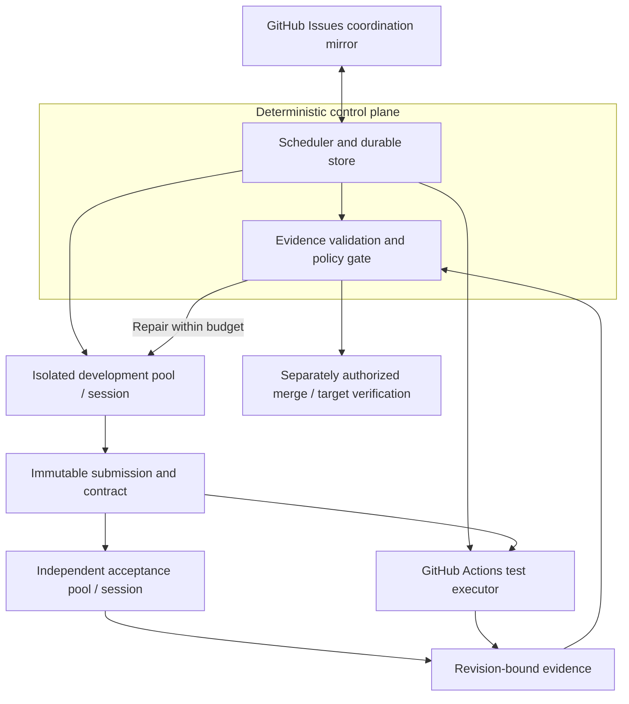

# Fully managed Git development

Status: Proposed durable engine; current autonomous lifecycle retained · Date: 2026-10-26

Humans set project direction and describe features. ClawFlow should carry eligible work through implementation, testing, repair and delivery within configured permissions and resource limits. There is one autonomous lifecycle; normal analysis and planning happen inside implementation.

[Implementation notes](managed-development-design-detail.md) hold the proposed data contracts, recovery rules and acceptance matrix. [CLI interaction design](cli-interaction-design.md) describes the control surface. Proposed schemas and commands are not current capabilities.

## Current runner

Eligible open leaf issues enter `implement` directly. Questions/comments retain their reply paths, and parents retain `track-progress` with the operational `progress-check` trigger. Local lockfiles, machine bindings, pause/cancel controls, terminal exclusions, bounded retries and historical records remain.

Historical source baseline `f9e1c8e` launched Claude directly. Integration branch `feat/independent-acceptance` combines the existing `feat/offload-execution` work with the independently accepted CI fix. The installed binary still reports `74771e2-offload`; validate and record the selected source/executor versions before live self-hosting.

```bash
clawflow repo set owner/repo --auto-merge on --ci-required on
clawflow repo enable owner/repo
clawflow run --repo owner/repo
```

Required CI must succeed before configured merge; missing, pending, failed or unreadable checks block it. Failed-CI repair currently targets supported same-repository GitHub managed PRs: reproduce locally, update the same branch without force, reserve at most three attempts per PR, and wait five minutes between attempts. Bounded, redacted GitHub job-log excerpts for the exact head SHA are untrusted diagnostic evidence, never CI status. Missing/expired logs mean no evidence. Forks and GitLab repair remain excluded; other GitLab capabilities remain.

Read the same evidence with `clawflow ci job log --repo owner/repo --sha <full-head-SHA> [--job <job-id>]`. GitHub never supports `--raw`. Retrieval is limited to 30 seconds, 100 runs and 100 jobs per inspected run (incomplete lists yield no evidence), ten inspected runs/log downloads, and three excerpts with 4 KiB tails. Downloads over 4 MiB are discarded. Configured credentials and recognizable token/secret patterns are redacted before truncation; arbitrary application secrets without recognizable context cannot be guaranteed detectable. Log text and metadata are JSON-quoted untrusted data. The CI adapter alone determines status; a missing excerpt cannot establish success.

The exact built-ins `classify`, `evaluate-bug`, `evaluate-feat` and `decompose` are retired, including same-name user overrides. Other custom operators and history remain. The eval model role serves only custom `evaluate-*` extensions. Old configuration remains readable; explicit legacy selection emits a migration notice and continues autonomously. Rewrites omit `workflow`, `auto_approve`, `auto_evaluate_all_issues` and `confidence_threshold`, preserving enablement, bindings, merge/CI and other supported settings.

## Proposed durable engine

Support tens to hundreds of projects, with a target of 10,000 concurrent workers. This is a design and validation target, not proven capacity. Actual concurrency depends on execution-provider capacity, GitHub Actions runners, API limits and project budgets.

Evolve the existing Go application as a modular monolith, reusing project management, VCS and operator modules and the integrated Offload execution adapter. The durable, deterministic control plane owns tasks, transitions, evidence and external-effect authorization. GitHub Issues, labels and comments mirror coordination; the durable store is authoritative. Prompts and worker conversations cannot advance state themselves.

Start with one scheduler. PostgreSQL via GORM is the single required store (decision: [storage-design.md](storage-design.md)); there is no SQLite reference implementation. Production scale also requires leased and fenced workers, durable outbox/inbox delivery and fair project, provider and resource quotas. Extract services only for measured bottlenecks or an independent security, failure-isolation or scaling need.

Versioned skill packages describe activities, tests, policy and bounded execution steps. Project bindings pin their resources. The engine validates results, owns transitions and enforces permissions; a prompt cannot waive checks. This does not introduce a repository workflow-mode selector or a second legacy pipeline.

Users connect a repository and execution environment, provide project/test instructions, validate readiness, then enable automation. They observe progress and blocking reasons, pause/cancel or supply missing information. CLI task planning, durable status/retry commands and package binding contracts remain proposed where marked in the detailed design.

Development and acceptance use separate sessions, credentials and capabilities in ephemeral, isolated worker pools. Acceptance records its plan from the pinned contract and requirements before reading implementation details or development conclusions. It then inspects and tests the immutable submission but cannot modify its source or authorize its own policy relaxation. Evidence binds the contract, exact code SHA, integration/base SHAs and policy digest.

The intended delivery path separates execution from authority:



GitHub Actions is a first-class test executor. Reuse [the existing CI workflow](../.github/workflows/ci.yml): web build, Go race tests and CLI smoke checks. Waiting for CI persists the run identity and releases the worker slot. Results record run/job IDs and attempts plus trusted workflow identity/digest. Required evidence must be complete, current and successful; missing, skipped or stale results cannot pass. A PR test merge SHA is explicitly bound to its head/base tuple, never assumed identical to the submitted head SHA.

Provider protections remain authoritative. Gate success creates merge eligibility only; it grants no automatic merge authorization. Existing explicit merge policy still applies, while production release/deployment remains separately configured work. Target-branch verification and general crash recovery are proposed guarantees, not established by PR creation or the current repair ledger.

External components use versioned capability adapters. Onboarding moves through `discovered → verified → bound → active`; discovery is read-only and components remain disabled until authorized activation. Unknown components are reported as unsupported or awaiting verification, never invented or automatically onboarded.

## Scope and implementation order

Delivery backlog: [parent #347](https://github.com/zhoushoujianwork/clawflow/issues/347).

1. Fix [exact-SHA CI aggregation #348](https://github.com/zhoushoujianwork/clawflow/issues/348), establish the [independent gate #349](https://github.com/zhoushoujianwork/clawflow/issues/349), and [reuse Actions #350](https://github.com/zhoushoujianwork/clawflow/issues/350).
2. Add [durable workflow, fencing and reconciliation #351](https://github.com/zhoushoujianwork/clawflow/issues/351); coordinate and implement the existing [dependency-gate backlog #337](https://github.com/zhoushoujianwork/clawflow/issues/337), currently OPEN and `agent-skipped`, not an implemented gate. Prove failure, repair, permitted merge and target verification across restart.
3. Add [component adapters and management #352](https://github.com/zhoushoujianwork/clawflow/issues/352), preserving project/VCS/operator modules and reconciling Offload reuse.
4. Add the distributed backend and [scale validation #353](https://github.com/zhoushoujianwork/clawflow/issues/353) at 100, 1,000 and 10,000 workers across 100 projects. Distinguish synthetic control-plane capacity from real provider capacity; raise supported limits only from measured results.

Roll out versioned contracts and store migrations incrementally, with one authority per task and bounded project cohorts; do not add an alternate legacy workflow selector. Defer arbitrary scripting, a marketplace and automatic production deployment. The [trigger expansion ADR](adr/0001-trigger-surface-expansion.md) remains a historical Proposed decision; this design does not change its status. Technical contracts, failure tests and scale acceptance are in the [detailed design](managed-development-design-detail.md).
