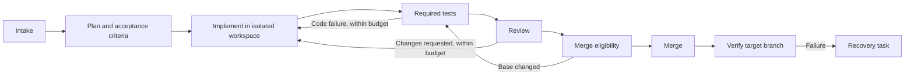

# Fully managed Git development

Status: Proposed · Date: 2026-10-26

This document defines product scope and architectural choices. [Implementation notes](managed-development-design-detail.md) describe the proposed contracts and recovery rules. Names and configuration examples there are proposals, not supported commands or configuration today.

## Goal

Turn ClawFlow into a service that takes an accepted Git issue through planning, implementation, testing, review, and merge, then verifies the result. Users configure how their projects work by installing and binding skills. ClawFlow continuously advances work within those configured permissions and resource limits.

“Fully managed” means automatic progress and recovery for supported work, with an explicit blocked state when requirements, credentials, infrastructure, or policy prevent progress. It does not mean treating every agent response as success or retrying indefinitely.

## Current project assessment

Source review at base commit `dff005a` shows a useful automation foundation already exists. This assessment is static inspection, not a claim that the current full test suite or live integrations passed.

| Area | Current capability | Change needed for managed development |
|---|---|---|
| Skills | Embedded and user-overridden `SKILL.md` operators; label matching and outcome markers | Versioned packages, typed results, explicit workflow and test contracts |
| Execution | Claude execution, provider failover, parallel jobs, isolated implementation worktrees and partial-work reuse | Durable step ownership, checkpoints, and bounded transition rules |
| Recovery | Local run metadata/events, lock cleanup and stale-run reconciliation | Reconcile unfinished external effects and prove each required step completed |
| Git delivery | Auto-approval, CI-gated auto-merge and recurring merge sweep already exist | Centralize these actions behind revision-bound evidence and project policy |
| Testing | Project test instructions and CI tooling exist | Enforce normalized test evidence in the runner; manage test-profile setup and activation |
| Triggers | Issue/label scanning; PR merge sweep | General PR-step dispatch and normalized events; complete pagination and reconciliation |

The old documentation's label-lock description is stale: runtime locking now uses local lockfiles. The existing PR merge sweep also must not be confused with general PR operator dispatch, which remains deferred in the scanner. [Source references and migration map](managed-development-design-detail.md#existing-code-and-migration-map) distinguish reused capabilities from proposed additions.

## User experience

1. Connect a GitHub or GitLab repository and select an execution environment.
2. Select a workflow skill and compatible development, review, and test skills. ClawFlow validates the configuration and displays the resolved workflow, required credentials, test gates, and merge policy.
3. Run onboarding checks against a disposable workspace. Review proposed CI changes through a configuration PR when needed.
4. Enable managed mode. New eligible issues enter the workflow automatically; existing labels and manual triggers remain useful entry points.
5. Follow a single task timeline showing its current step, code revision, tests, cost or usage where available, retries, and any blocking reason. Pause, cancel, resume, or supply missing information from the same view.

The default built-in workflow is:

Infrastructure failures retry the affected test operation with backoff; they do not automatically become code changes. Any new code revision invalidates affected test and review evidence. Planning can create dependent subtasks; the parent finishes only after their required outcomes are verified.

## Architectural choice

Keep the Go application as the orchestration kernel and evolve the existing skill system into versioned executable contracts. Keep the CLI, Web interface, VCS adapters, and existing agent execution integrations. This is an evolution of the existing product, not a separate SaaS rewrite.

| Layer | Responsibility |
|---|---|
| Git integration | Normalize issues, PRs/MRs, comments, refs, CI runs, and merge capabilities into events and commands |
| Workflow engine | Persist tasks and attempts; schedule eligible steps; enforce dependencies, budgets, leases, and recovery |
| Skill registry | Validate, resolve, pin, and load workflow, activity, test, and policy packages |
| Execution adapters | Run agents or deterministic commands in isolated workspaces; collect structured outputs and artifacts |
| Evidence and policy | Determine whether required tests, reviews, and merge conditions hold for the current revision |
| CLI and Web | Configure projects and inspect or control the same durable workflow state |

Labels and comments remain visible coordination surfaces. Managed runs need their own durable execution ledger as the authority for scheduling and recovery; labels alone cannot represent attempts, leases, revisions, and partial external writes. Use a single-host store first, with one active scheduler per store. Multi-host scheduling is a later deployment capability.

This deliberately changes the earlier direction of keeping all coordination in labels and avoiding explicit workflow definitions. The existing [trigger expansion ADR](adr/0001-trigger-surface-expansion.md) is still Proposed; this design proposes a small validated workflow graph inside skills for managed mode, while retaining label-driven legacy mode. It does not change that ADR's status or claim an accepted migration decision.

## Everything configurable through skills

Use one package format with different responsibilities:

- **Workflow skills** declare steps, dependencies, allowed transitions, and bounded repair loops.
- **Activity skills** implement planning, coding, review, or other bounded work through an agent or command adapter.
- **Test skills** describe test discovery, environment requirements, execution, report collection, and gate evaluation.
- **Policy skills** declare permitted actions, required evidence, retry and usage limits, and escalation rules.

Each package has a `SKILL.md` entry point, machine-readable metadata, and optional scripts, templates, and referenced documents. Project bindings select versions and provide parameters; they do not become a second independent workflow definition. The framework validates metadata before execution and only injects the selected instructions and resources into an agent.

The kernel remains responsible for enforcing contracts. A skill can request a merge, but cannot override required checks or expand the permissions granted by its project. Agents propose changes and results; platform adapters perform controlled Git/VCS side effects.

## Automated testing as a complete workflow

Test configuration must have its own lifecycle: **discover → propose → validate → activate → execute → collect evidence → repair or advance**.

During onboarding, a discovery skill identifies existing test commands, CI jobs, dependencies, and missing configuration. A setup skill proposes additions without silently replacing existing CI. Activation requires a successful preflight and a pinned test profile. Missing credentials, unavailable runners, or no collected tests remain visible blockers unless project policy explicitly permits that condition.

During development, test skills run local checks and/or provider CI, publish logs and reports, and return normalized results. Required checks are tied to the code revision, test configuration, and environment. A test plan can select checks based on change scope, but cannot remove the project's minimum required checks. CI pending, missing evidence, and infrastructure errors are distinct from pass or code failure.

Configuration changes use a separate configuration workflow: validate the new profile, create its PR, run the existing required gates plus the new profile's acceptance checks, then activate the new version for future runs. Active runs retain their pinned configuration unless explicitly restarted. Code-writing agents cannot silently weaken tests to make a task pass.

## Autonomy and completion

Offer project-level modes using the same workflow: plan only, develop through PR, or manage through merge. A project may authorize automatic merge once its required gates pass; repository protections and actual provider capabilities still apply. Release and production deployment are separate opt-in workflows.

A development task is complete only when its requested changes have merged and required target-branch checks have passed, or when the selected mode's explicit endpoint has been reached. PR creation, a successful agent process, and an agent's written claim of completion are intermediate facts.

For a changed base branch, revalidate the integration revision before merge. If the provider cannot enforce that required revision or an equivalent merge-queue check, automatic merge remains blocked. Post-merge failures create a linked recovery task; automatic revert requires an explicit project policy and verified applicability.

## Delivery scope and order

| Phase | Deliverable | Acceptance condition |
|---|---|---|
| 1. Reliable kernel | Durable tasks/attempts, typed results, leases, reconciliation, legacy skill adapter | Restart during execution or VCS write recovers without blindly duplicating work |
| 2. Skill loading and tests | Versioned packages, project bindings, configuration preflight, command and CI test adapters | One repository runs a pinned test profile and distinguishes code failure, infrastructure failure, and missing evidence |
| 3. Managed development | Issue-to-PR flow, review, bounded repair, merge gate, target-branch verification | One issue completes unattended on a test repository with an auditable evidence chain |
| 4. Platform operation | Dependent tasks, project fairness, Web configuration/timeline, additional provider parity | Multiple projects progress independently; one blocked or expensive task cannot monopolize execution |

Start with one concrete workflow and the existing execution backend. Make GitHub and GitLab capability differences explicit and test both adapters; do not assume every feature is interchangeable. Defer arbitrary workflow scripting, a marketplace, distributed scheduling, and automatic production deployment.

The first milestone should prove one full vertical path: **issue → implementation → test failure → repair → successful tests → reviewed PR → permitted merge → target-branch verification**, including a process restart. Adding more prompt-based operators before this path is reliable would leave the central orchestration problem unresolved.
