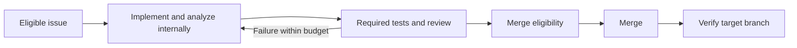

# Fully managed Git development

Status: Proposed durable engine; current autonomous lifecycle retained · Date: 2026-10-26

Humans set project direction and describe features. ClawFlow should carry eligible work through implementation, testing, repair and delivery within configured permissions and resource limits. There is one autonomous lifecycle; normal analysis and planning happen inside implementation.

[Implementation notes](managed-development-design-detail.md) hold the proposed data contracts, recovery rules and acceptance matrix. [CLI interaction design](cli-interaction-design.md) describes the control surface. Proposed schemas and commands are not current capabilities.

## Current runner

Eligible open leaf issues enter `implement` directly. Questions/comments retain their reply paths, and parents retain `track-progress` with the operational `progress-check` trigger. Local lockfiles, machine bindings, pause/cancel controls, terminal exclusions, bounded retries and historical records remain.

```bash
clawflow repo set owner/repo --auto-merge on --ci-required on
clawflow repo enable owner/repo
clawflow run --repo owner/repo
```

Required CI must succeed before configured merge; missing, pending, failed or unreadable checks block it. Failed-CI repair currently targets supported same-repository GitHub managed PRs: reproduce locally, update the same branch without force, reserve at most three attempts per PR, and wait five minutes between attempts. CI logs, forks and GitLab repair are excluded; other GitLab capabilities remain.

The exact built-ins `classify`, `evaluate-bug`, `evaluate-feat` and `decompose` are retired, including same-name user overrides. Other custom operators and history remain. The eval model role serves only custom `evaluate-*` extensions. Old configuration remains readable; explicit legacy selection emits a migration notice and continues autonomously. Rewrites omit `workflow`, `auto_approve`, `auto_evaluate_all_issues` and `confidence_threshold`, preserving enablement, bindings, merge/CI and other supported settings.

## Proposed durable engine

Evolve the existing Go application, CLI, Web views, VCS adapters and execution backend. Add one durable authority for tasks, attempts, evidence and pending external effects. Keep labels and comments as visible coordination surfaces. Start with one scheduler and a local transactional store; distributed scheduling is deferred.

Versioned skill packages describe activities, tests, policy and bounded execution steps. Project bindings pin their resources. The engine validates results, owns transitions and enforces permissions; a prompt cannot waive checks. This does not introduce a repository workflow-mode selector or a second legacy pipeline.

Users connect a repository and execution environment, provide project/test instructions, validate readiness, then enable automation. They observe progress and blocking reasons, pause/cancel or supply missing information. CLI task planning, durable status/retry commands and package binding contracts remain proposed where marked in the detailed design.

The intended delivery path is:



Tests and review evidence must match the current revision and configuration. Infrastructure failures use bounded backoff; missing evidence blocks completion. Provider protections remain authoritative. Production release/deployment remains separately configured work. Target-branch verification and general crash recovery are proposed guarantees, not established by PR creation or the current repair ledger.

## Scope and implementation order

1. Establish durable task/attempt ownership, typed results and reconciliation of interrupted writes, preserving existing custom operators and history.
2. Add pinned skill resources and validated test profiles with explicit environment requirements and normalized evidence.
3. Prove one issue through test failure, bounded repair, successful checks, permitted merge and target-branch verification, including process restart.
4. Add dependent tasks, fairness, richer Web/CLI views and provider parity after the vertical path is reliable.

Defer arbitrary scripting, a marketplace, distributed scheduling and automatic production deployment. The [trigger expansion ADR](adr/0001-trigger-surface-expansion.md) remains a historical Proposed decision; this design does not change its status. Existing runtime/source observations and future contracts are separated in the [detailed design](managed-development-design-detail.md).
