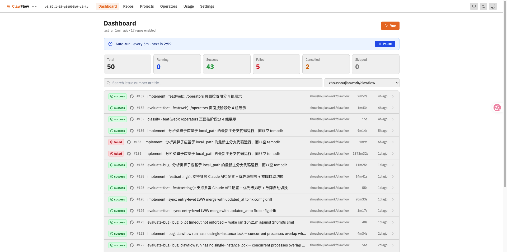
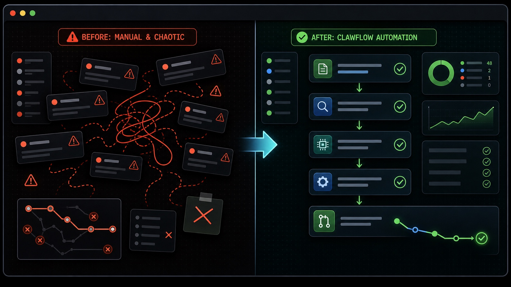
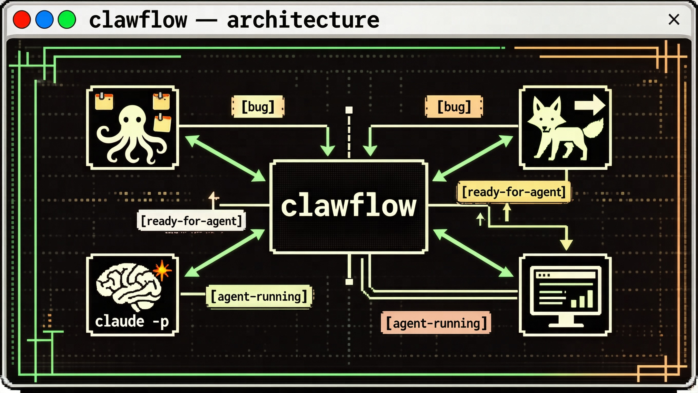

# ClawFlow

> **Label-driven automation that turns issues into PRs on GitHub and GitLab.**
>
> ClawFlow polls the repositories you configure, matches each open issue/PR against a set of **operators** (self-contained `SKILL.md` files), and runs the matching operator through `agent-host execute`. VCS labels and comments expose progress; local files retain run history, execution locks and bounded CI-repair attempts. There is no SaaS backend. Run it once, run it on cron, run it from your editor — it's the same binary either way.



The local dashboard (`clawflow web`) gives you a filterable timeline of every operator run across every monitored repo — status, duration, PR links, and a replay of the raw AGH event stream (usage is currently unknown) for any past run.

---

## Trigger a manual GitLab deployment

After approving a change and its target environment, start an existing manual
deployment job from the CLI:

```bash
clawflow ci pipeline list --repo https://gitlab.company.com/group/project --ref main
clawflow ci pipeline view --repo https://gitlab.company.com/group/project --id 12345
# Select the manual deployment job ID from the pipeline's job list.
clawflow ci job play --repo https://gitlab.company.com/group/project --id 67890
clawflow ci job log --repo https://gitlab.company.com/group/project --job 67890
```

`job play` (alias `job trigger`) calls GitLab's
[manual job API](https://docs.gitlab.com/api/jobs/#run-a-job), equivalent to its
play button. Keep `when: manual`; the selected job defines the deployment target.
The command returns the accepted job status and URL; check the pipeline and logs
for completion. Add `--json` for structured output. Your GitLab token needs `api`
scope and permission to run the job; protected-environment approvals still apply.

## Manage project CI/CD variables

Manage the variables on GitLab's **Settings > CI/CD** page:

```bash
clawflow ci variable list --repo https://gitlab.company.com/group/project
clawflow ci variable view --repo https://gitlab.company.com/group/project --key DEPLOY_TARGET
clawflow ci variable create --repo https://gitlab.company.com/group/project --key DEPLOY_TARGET --value staging
clawflow ci variable update --repo https://gitlab.company.com/group/project --key DEPLOY_TARGET --value qa
clawflow ci variable delete --repo https://gitlab.company.com/group/project --key DEPLOY_TARGET
```

Values are redacted by default, including `--json` output. Add `--show-values`
to display values explicitly. For secrets or multiline/file variables, use
`--value-file /path/to/value` or `--value-file -` for stdin instead of putting
the value on the command line. Create and update require a value, which can be
an explicit empty string (`--value ''`). Optional flags include `--type env_var|file`,
`--protected`, `--masked`, `--raw`, and `--description`; omitted settings are
preserved during updates, and explicit boolean false values are supported.

For environment-specific variables, `--scope production` sets the scope on
create and selects the exact existing scope on view/update/delete. These use
GitLab's [project variables API](https://docs.gitlab.com/api/project_level_variables/);
newer attributes and environment scopes depend on your server's support. The
commands reuse the configured GitLab token and enforce the Pilot write budget.

## Why ClawFlow



Two pain points the project targets head-on:

- **Issues wait for manual handoffs.** Eligible open leaf issues go directly to `implement`, which analyzes the request, writes code, tests and repairs internally, then opens a PR. Humans set direction and describe features; parent issues retain `track-progress` monitoring.
- **Config drift across machines.** Repos you added on the work laptop don't exist on the home laptop. `clawflow sync push/pull` ships your `config.yaml` (minus tokens and local paths) through a private GitHub Gist — `clawflow login` auto-discovers or creates it. No SaaS, no extra account.

---

## Install

```bash
curl -fsSL https://raw.githubusercontent.com/zhoushoujianwork/clawflow/main/get.sh | bash
```

Supports macOS (Apple Silicon & Intel) and Linux (x86_64 & arm64). The installer:

- Downloads the right binary for your platform into `~/.clawflow/bin/clawflow`
- Initializes `~/.clawflow/config/` with a template config
- Adds `~/.clawflow/bin` to your shell `PATH`

You also need Agent-Host with the execution CLI and explicitly configured execution config, native command and native profile paths. See [AGH execution setup](docs/agh-execution-design.md). ACP currently supports Claude only; ClawFlow never launches a native backend directly.

---

## Setup

### 1. Store tokens

**GitHub:**
```bash
clawflow config set-token ghp_xxxxxxxxxxxx
```
Required scopes: `repo` (full), `read:org`.

**GitLab:**
```bash
clawflow config set-gitlab-token glpat-xxxxxxxxxxxx
```
Required scopes: `api`.

Tokens are saved to `~/.clawflow/config/credentials.yaml` (mode 0600). Environment variables take priority: `GH_TOKEN`, `GITLAB_TOKEN`.

### 2. Add repositories to monitor

`repo add` auto-detects the platform from the input — no flags needed in most cases:

```bash
# GitHub — URL, SSH, or short form
clawflow repo add https://github.com/owner/repo
clawflow repo add git@github.com:owner/repo.git
clawflow repo add owner/repo

# GitLab self-hosted — full URL (nested namespaces supported)
clawflow repo add https://gitlab.company.com/ns/group/repo

# Local directory — reads .git/config origin automatically
clawflow repo add .
clawflow repo add ~/github/my-repo
```

Override platform or instance URL manually:
```bash
clawflow repo add ns/repo --platform gitlab --base-url https://gitlab.company.com
```

Manage repos:
```bash
clawflow repo list
clawflow repo set owner/repo --auto-merge on --ci-required on
clawflow repo enable  owner/repo
clawflow repo disable owner/repo
clawflow repo remove  owner/repo
```

### 3. Initialize labels

Labels are created automatically on `repo add`. To (re)create them manually:

```bash
clawflow label init owner/repo
```

Eligible open leaf issues enter implementation automatically. Questions retain their reply path; `agent-mentioned` triggers comment replies, and `progress-check` is the operational trigger for parent tracking.

| State | Meaning |
|---|---|
| `agent-implemented` | Implementation produced a PR. |
| `agent-failed` | Execution failed; inspect its report before retrying. |
| `agent-skipped` | Work was declined or excluded. |
| `agent-replied` | The latest mention was answered. |

Execution uses local lockfiles in `~/.clawflow/locks/`. The old `agent-running` label is not a concurrency lock. Pause/cancel controls, machine bindings, terminal exclusions and bounded retries still apply.

Reopened issues can start another implementation cycle when lifecycle history proves a close/reopen after the previous implementation label and no linked PR remains open. Earlier branches and worktrees are preserved. Read [reopened issues and history](docs/reopened-issues.md) for details.

```bash
clawflow issue history 7 --repo owner/repo --json
```

### 4. Run

```bash
clawflow run
```

Scans every enabled repo once, runs any matching operators, exits. Schedule it with cron, launchd, or your editor's agent; local history persists between invocations.

---

## How It Works



A single CLI binary scans enabled, machine-bound repositories and runs eligible work through `agent-host execute`:

1. Route ordinary open leaf issues directly to `implement`; keep question/comment replies and parent tracking on their own paths.
2. Acquire a local execution lock and prepare an isolated implementation worktree.
3. Analyze, plan, implement, run focused tests and repair inside the implementation attempt.
4. Publish the result and PR, then release the lock. Required CI must succeed before configured auto-merge; missing, pending, failed or unreadable checks block merging.

For unattended delivery:

```bash
clawflow repo set owner/repo --auto-merge on --ci-required on
clawflow repo enable owner/repo
clawflow run --repo owner/repo
```

Self-upgrade (optional, off by default) is meant only for the repository that contains ClawFlow's own source: `clawflow repo set owner/repo --self-upgrade on`. After a `clawflow run` pass that confirmed a merge into that repository's base branch (acceptance harvest, inline or sweep auto-merge), the last step of the pass fetches `origin/<base>` in `local_path`, builds the web bundle and the binary in a temporary detached worktree (your checkout is never touched), checks that the candidate reports the new short SHA and that `execution check --json` is `ready`, then atomically replaces the running executable and keeps the old one as `<path>.prev`. A running local `clawflow web` is restarted in a detached session. Any failure leaves the installed binary unchanged (or restores `.prev`), logs a WARN `run/self_upgrade` line and makes the run exit non-zero. It is skipped when the installed version already equals the target or another upgrade holds the local lock. Requires `git`, `pnpm` and `go` on the machine.

Failed CI repair is limited to supported same-repository GitHub managed PRs. It reproduces failures locally, updates the existing branch without force, reserves at most three attempts per PR and waits five minutes between attempts. It does not ingest CI logs or repair forks or GitLab MRs. Other GitLab issue, MR and CI commands remain available.

This is the current runner, with local history and repair bookkeeping. The [managed development design](docs/managed-development-design.md) proposes a broader durable task/effect engine; that engine is not implemented by these controls.

---

## Architecture: Operators

An **operator** is a single `SKILL.md` file — frontmatter plus a prompt — that declares:

- **Trigger**: which issues/PRs it runs on (target type + required labels + excluded labels)
- **Outcome**: the result label emitted in stdout; `lock_label` is compatibility metadata, not a mutex
- **Body**: the prompt that `agent-host execute` receives, with issue context injected

Operators live in two places:

- **Built-in**: `skills/<name>/SKILL.md` inside this repo — embedded into the binary at build time.
- **User overrides**: `~/.clawflow/skills/<name>/SKILL.md` — same name overrides the built-in.

The exact names `classify`, `evaluate-bug`, `evaluate-feat` and `decompose` are retired and rejected in user overrides too. Other custom operators and historical records remain. The eval model role is used only by custom `evaluate-*` extensions, with no built-in evaluation pipeline.

That is the current extension model. To add a new operator, drop a `SKILL.md` in one of those directories. No plugin API, no registration step.

See [`CLAUDE.md`](CLAUDE.md) for the frontmatter schema and operator design principles.

---

## Tracking Issues & Sub-issues

For large features that span multiple implementation tasks, ClawFlow supports a **tracking issue** pattern backed by GitHub's native sub-issue relationship.

### How it works

1. Create a parent and link its implementation tasks using the sub-issue commands below.
2. Eligible leaf issues proceed through implementation independently; normal analysis stays inside `implement`.
3. Each scan supplies `progress-check` to `track-progress` for eligible parents. Pending children produce `agent-watching`; when all children finish, `agent-closed` closes the parent.

`tracking` marks coordinating work and excludes direct implementation. `progress-check` is an operational trigger, not a user approval stage. No automatic decomposition operator is provided.

### CLI commands

```bash
# Link an existing issue as a sub-issue of a parent
clawflow issue add-sub --repo owner/repo --parent 10 --sub 11

# List all sub-issues of an issue
clawflow issue list-sub --repo owner/repo --issue 10
clawflow issue list-sub --repo owner/repo --issue 10 --json
```

GitLab does not have a native sub-issue API — `add-sub` and `list-sub` return an error on GitLab repos. Existing checklist-based tracking remains available where supported; native sub-issue commands remain GitHub-only.

### Work queue (one queue for all repositories)

All enabled repositories, GitHub and GitLab, share one ClawFlow-native queue. Candidates are the open leaf issues `implement` would accept, narrowed by the repo's `queue_scope` (`clawflow repo set owner/repo --queue-scope all|labeled|ranked`; empty falls back to `settings.queue.scope`, then `all`):

- `all`: every eligible issue.
- `labeled`: only issues labeled `clawflow`.
- `ranked`: only issues listed in the rank file, plus issues labeled `clawflow`, which are appended to the rank on the pass that sees them (`queue/enroll`).

An unknown value falls back to `ranked` for repos that ever had `queue_issue` (unlisted work is never picked up), else `all`. `clawflow repo set` rejects unknown values. Issues already in flight always count, whatever the scope.

Order is `(priority, rank, created_at, key)`:

- Priority is the label `P0`..`P3` (exact, case-sensitive; the highest wins; none = `P2`). Look-alikes such as `p1` or `priority:1` are ignored and reported once in `queue/format_warning`.
- Rank is the manual order in `~/.clawflow/data/queue.json` within a tier. Change it with `clawflow queue move owner/repo#12 --top | --bottom | --before K | --after K`.
- Dependencies: one body line `Depends on: #12, owner/repo#34` (max 10). Items wait while a dependency is open; a cycle blocks all its members (`dependency_cycle`).

```bash
clawflow queue list [--repo R] [--json]   # global order: key, tier, rank, scope, state
clawflow queue move owner/repo#12 --top
clawflow queue add owner/repo#13 [--top | --before K | --after K]   # enroll (default: bottom)
clawflow queue remove owner/repo#13                                 # drop from the rank
clawflow repo set owner/repo --max-in-flight 3   # per repo, default 2
```

Each pass walks the order for its repositories and dispatches while the repo's `max_in_flight` and the global `settings.max_concurrent_agents` allow. An item is in flight while it holds a local lock, or carries `agent-implemented` with an open PR that references it. Blocked items (`agent-failed`, red CI without repair, no acceptance verdict, open dependency) are skipped with a recorded reason and never stall the queue. An in-flight item blocked longer than `settings.queue.park_after` (default `45m`) is parked and stops counting toward `max_in_flight` (at most 2 per repo). Logs: `queue/pick`, `queue/skip`, `queue/park`, `queue/unpark`, `queue/format_warning`, `queue/import`. Targeted runs (`clawflow run --repo R --issue N`) bypass the queue.

`queue_issue` is deprecated. On the first pass its open sub-issues are imported into the rank (`clawflow queue import --repo R --from-issue N` does the same by hand), the repo is set to `queue_scope: ranked` unless it already has an explicit scope, and the field is then ignored. If the config write fails, implement is held back for that repo and the migration retries next pass. The old queue issue is left untouched.

---

## Configuration migration

There is one autonomous lifecycle and no workflow selector. Old configuration input remains readable; explicit legacy selection produces a migration notice and continues autonomously. Rewritten configuration omits `workflow`, `auto_approve`, `auto_evaluate_all_issues` and `confidence_threshold`, preserving enablement, bindings, merge/CI settings and other supported settings. Old labels and history are retained as records, not implementation prerequisites.

## Config Sync (multi-machine)

Working across multiple machines? `clawflow sync` keeps your repo list and settings in sync via a **private GitHub Gist** — no extra account, no SaaS backend.

```bash
# 1. Authenticate first (stores token + discovers/creates the Gist)
clawflow login <github-token>

# 2. First machine: push local config to the private Gist
clawflow sync push

# 3. Second machine: authenticate, then pull and merge
clawflow login <github-token>
clawflow sync pull

# Preview the diff before applying
clawflow sync
```

**What syncs:**

| Field | Synced? | Notes |
|---|---|---|
| `repos` | ✅ | Union merge — repos from both sides are kept |
| `settings.*` | ✅ | Cloud wins on pull |
| `credentials` | ❌ | Never synced — tokens stay local |
| `local_path` | ❌ | Machine-specific — always kept from local copy |

The Gist ID is stored in `~/.clawflow/config/credentials.yaml` after the first push. `clawflow login` auto-discovers an existing `clawflow-config` Gist if you've pushed from another machine before.

---

For projects you want ClawFlow to actively triage (not just react to labeled issues), enable the **Pilot**:

```bash
clawflow project automation enable my-project --cooldown 30
```

Or flip the toggle in the dashboard's project detail page.

When on, every `clawflow run` pass — after operators finish — wakes a per-project Pilot (a non-interactive `agent-host execute` invocation rooted at `~/.clawflow/projects/<name>/`). The Pilot triages the backlog at the **edges** of the operator pipeline: file new work, fix missing trigger labels, close stale/duplicate issues, comment to explain decisions. Implementation and delivery stay owned by the runner, operators and repo-level merge/CI controls.

#### Pilot's working files

`~/.clawflow/projects/<name>/` carries the Pilot's whole world:

| File | Owner | Role |
|---|---|---|
| `CLAUDE.md` | clawflow (auto-generated) | Member repo loader. Refreshed from `project.yaml` on every wake; auto-loaded by `agent-host execute` so the Pilot always knows which repos belong and where they live locally. Don't hand-edit — your changes get overwritten. |
| `context.md` | **the Pilot itself** | The Pilot's evolving working memory. Read at wake start. The Pilot may rewrite it at wake end via a fenced ` ```context.md ``` ` block when something material was learned. Versioned by the project-level git repo. |
| `deployment.md` | you | Optional: log-retrieval / health-check commands. When present, the Pilot inspects logs before triaging the backlog (production errors take priority over tracker work). |
| `testing.md` | you | Optional: local-environment SOP. Used by the `implement` operator, not the Pilot. |

#### What the Pilot wakes with

Each wake's prompt carries: `context.md` (own memory), `deployment.md` (if present), the **last 3 wakes' `PILOT-RESULT` lines** (short-term memory — prevents the Pilot from re-doing what it already did), and the current backlog snapshot (open issues + PRs across all member repos).

#### Closed loop

```
clawflow run
  → operators process labeled issues
  → Pilot wakes (cooldown-gated, per project)
      → reads context.md / recent history / live backlog
      → triages: file/label/close/comment (≤2 new issues per wake)
      → optionally rewrites context.md
  → next clawflow run pass executes the changes
```

`--cooldown` (default 30 min) throttles wakes so a fast cron doesn't fire on every pass. Disable with `clawflow project automation disable my-project`.

---

## Directory Layout

```
~/.clawflow/                          ← user data
├── bin/clawflow                      ← CLI binary
├── config/
│   ├── config.yaml                   ← repos to monitor
│   ├── credentials.yaml              ← tokens (0600)
│   └── install.yaml                  ← install record
├── projects/                         ← multi-repo project groupings
│   └── my-project/
│       ├── project.yaml              ← member repos + automation config
│       ├── CLAUDE.md                 ← auto-gen Pilot repo loader
│       ├── context.md                ← Pilot's evolving memory (Pilot writes)
│       ├── deployment.md             ← optional: log/health commands
│       └── testing.md                ← optional: local-env SOP
└── skills/                           ← user-custom operators (override built-ins by name)
    └── my-operator/
        └── SKILL.md

clawflow/ (this repo)
├── cmd/clawflow/                     ← Go CLI source
├── internal/
│   ├── config/                       ← config parsing + write
│   ├── operator/                     ← operator loader + runner
│   ├── project/                      ← project grouping CRUD
│   └── vcs/                          ← platform-agnostic VCS client (GitHub + GitLab)
├── skills/                           ← built-in operators (embedded at build time)
│   ├── track-progress/SKILL.md
│   ├── implement/SKILL.md
│   └── reply-comment/SKILL.md
└── agent-skills/                     ← agent skills for AI coding tools
    └── clawflow/SKILL.md             ← teaches AI tools the clawflow CLI
```

---

## CLI Reference

Commands are organized by category. Run `clawflow <cmd> --help` for flags.

| Category | Commands |
|---|---|
| **Core loop** | `clawflow run` — scan and execute matching operators once |
| **Operators** | `clawflow operators list` — show which operators are registered (built-in + user) |
| **Repos** | `clawflow repo add / remove / list / enable / disable` |
| **Labels** | `clawflow label add / remove / init` |
| **Issues** | `clawflow issue create / list / comment / close` |
| **PRs** | `clawflow pr create / list / view / comment / merge` |
| **Config** | `clawflow config set-token / set-gitlab-token / show` |
| **Sync** | `clawflow sync` — preview diff · `clawflow sync push` — upload to Gist · `clawflow sync pull` — merge from Gist |
| **Dashboard** | `clawflow web` — serve the local dashboard at http://127.0.0.1:8080 |
| **Update** | `clawflow update` — fetch the latest binary |
| **Operator helpers** *(invoked from SKILL.md bodies)* | `clawflow worktree` — create/remove per-issue git worktrees · `clawflow pr-check` — has an open PR for this issue? · `clawflow lang` — detect build/test commands for changed files · `clawflow status` — per-repo health summary |

> **Tool discipline:** return comments and outcome markers through stdout for runner write-back. Implementation has its documented Git/PR exception. Use `clawflow` for permitted VCS actions, never `gh`; see `CLAUDE.md`.

---

## Local dashboard (optional)

Every `clawflow run` writes JSON snapshots and per-run event logs to `~/.clawflow/dashboard/`. Launch the web UI with:

```bash
clawflow web --open          # serves http://127.0.0.1:8080 and opens your browser

# macOS：登录后启动，由 launchd 监督运行
clawflow web service install --host 127.0.0.1 --port 8090
clawflow web service status
clawflow web restart         # LaunchAgent 实例通过 kickstart 重启，并等待端口就绪
clawflow web service uninstall
```

服务日志写入 `~/.clawflow/logs/web.launchd.log`。重复安装相同配置不会重启服务；更改 host/port 后重新安装会重新加载服务。自升级沿用 `web restart`，保留 launchd 监督；非 LaunchAgent 实例仍使用原有的自行重启方式。

What it shows:

- **Dashboard** — filterable timeline of recent operator runs across every monitored repo, with status, duration, and PR links
- **Run detail** — replay of the raw AGH NDJSON event log (tool calls, assistant messages, final result) for any past run
- **Repos** — read-only view of every repo in `config.yaml` with per-repo run history
- **Operators** — active built-in and user operators with triggers, outcomes, and descriptions

The dashboard is a static SPA (React + Vite + Tailwind) read-only view — it does not call the GitHub/GitLab API itself. All state comes from files the CLI wrote. To refresh, run `clawflow run` and reload the page. The bundle is shipped inside the binary via `embed.FS`, so there is no Node toolchain required at install time.

If you prefer not to use `clawflow web`, point any static file server (`python3 -m http.server`, nginx, …) at `~/.clawflow/dashboard/` — it's self-contained.

---

## Claude Code integration (optional)

If you use [Claude Code](https://claude.ai/code), install the agent skills that teach Claude about ClawFlow:

```bash
clawflow install-skill
```

This installs the **clawflow** skill to `~/.claude/skills/`, teaching Claude the CLI commands for issue/PR/label operations.

For autonomous scheduling, use per-project automation (`clawflow project automation enable`) instead — it runs inside `clawflow run` and doesn't depend on Claude Code being open.

Skip the flag if you just want the CLI without AI tool integration.

---

## Supported Platforms

| Platform | Status | Notes |
|---|---|---|
| **GitHub** | ✅ | REST API v3 |
| **GitLab** | ✅ | REST API v4, self-hosted v11.11+ |

> Local quickstart: [Getting started with Claude Code](docs/quickstart-claude-code.md)

---

## Updating

```bash
clawflow update                    # fetch the latest binary
clawflow update --from-source      # rebuild from cloned repo (dev)
```

---

## Contributing / Extending

The project is deliberately small. To change behavior, you almost always want to edit or add an operator, not Go code:

1. Create `skills/<operator-name>/SKILL.md` (built-in) or `~/.clawflow/skills/<operator-name>/SKILL.md` (user).
2. Declare the frontmatter: `name`, `description`, `operator.trigger` and allowed `operator.outcomes`.
3. Write the prompt body.
4. Run `clawflow operators list` to confirm it's registered, then `clawflow run` to exercise it on a test issue.

Go CLI work goes under `cmd/clawflow/commands/` and `internal/`. The tight spot to touch for extending the loop itself is `internal/operator/`.

---

## License

MIT
